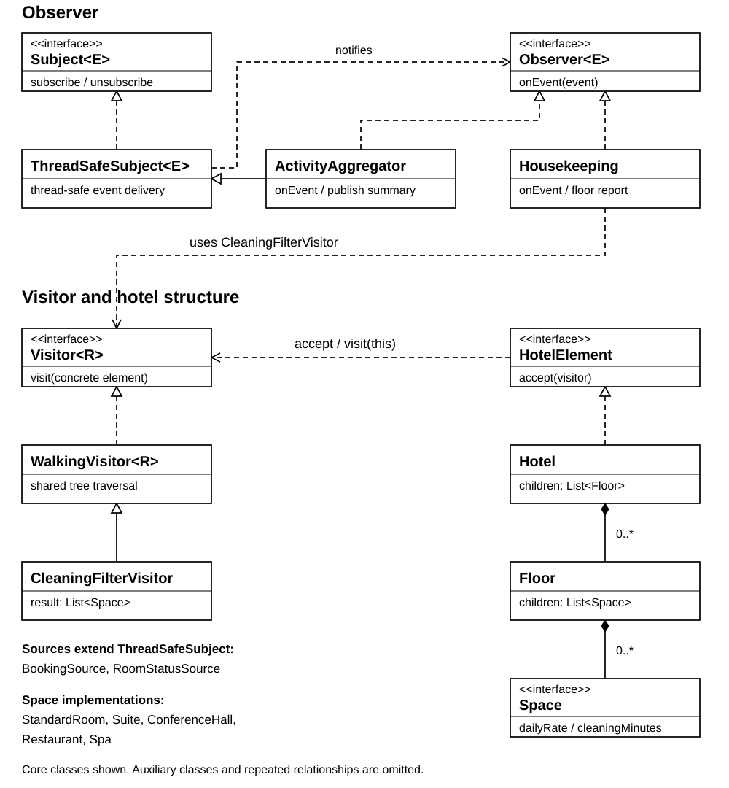

# Hotel Management - Assignment 6

Variant 20: Hotel management.

A Java console application demonstrating Observer and Visitor. Bookings and room changes
notify subscribers, while visitors generate reports for a hotel. Data is stored in memory.

## Run

Requires JDK 17 or newer and Maven. JUnit 5 is the only test dependency.

```sh
mvn test
mvn compile
java -cp target/classes hotel.Main
```

Use `--threads 4` to change the default pool size of 3.
Menu: 1 - reports, 2 - checkout 101, 3 - toggle guest notifications, 4 - booking,
5 - concurrent demo, 6 - JSON, 7 - event log, 0 - exit.
An optional JAR build is available through `scripts/build.ps1` on Windows.

## Design

**Observer.** Custom generic `Subject<E>` and `Observer<E>` interfaces connect two sources,
`BookingSource` and `RoomStatusSource`, to five listeners: FrontDesk, GuestNotifier,
AuditLog, ActivityAggregator and Housekeeping. Events are immutable and subscriptions are
per event type. Push delivery provides event data directly to handlers. ActivityAggregator
is also a subject and publishes a summary after every two events on a floor.

**Visitor.** The three-level tree is Hotel -> Floor -> Space. Hotel and Floor are containers;
StandardRoom, Suite, ConferenceHall, Restaurant and Spa are leaves. `Visitor<R>` uses double
dispatch through `accept`. Visitors control traversal, keeping calculations out of elements.
WalkingVisitor shares recursion; JsonExportVisitor handles nested output separately.

| Visitor | Operation |
| --- | --- |
| RevenueVisitor | Daily revenue from occupied spaces |
| OccupancyVisitor | Accumulated occupancy and cleaning statistics |
| CleaningFilterVisitor | List of vacant dirty spaces |
| JsonExportVisitor | Handwritten JSON with nesting and escaping |
| CleaningCostVisitor | Cleaning cost at a supplied rate per minute |

**Integration.** Checkout publishes ROOM_CHANGED. Housekeeping visits only the affected floor
and publishes CLEANING_REPORT. Checking out 101 reports 101 and 102 on F1, excluding F2.

**Concurrency.** ExecutorService runs three producer tasks with a configurable pool size.
Concurrent maps, atomic counters and queues protect shared state. CopyOnWriteArraySet permits
subscription changes inside handlers; callbacks already captured in a publication may still
run after unsubscription. Normal shutdown waits for accepted work and checks Futures.
Timeout/interruption is reported as a failure. Each report uses a new visitor and a copied
state map; concurrent producers have no global ordering. Main is the composition root,
with constructor injection and no lazy dependency initialization.

## Verification

30 JUnit tests cover subscriptions, observer chains, visitor values, JSON, integration and
shutdown. The stress test uses 4 threads x 1,000 events and expects exactly 4,000 audit
entries, 4,000 desk updates and 40 summaries. Tests passed on JDK 25.0.2 with release 17.

Initial results: revenue = 20,000 + 60,000 + 30,000 = 110,000 KZT; 5 spaces, 3 occupied,
3 dirty. Dirty-space effort = 40 + 60 + 50 = 150 minutes. Vacant dirty spaces are 102 and 202;
cleaning cost at 100 KZT/min = (40 + 50) x 100 = 9,000 KZT.

[UML diagram](docs/uml.svg) | [Console example](docs/demo-output.txt) | [JSON example](docs/hotel.json)



## Extension commits

[New visitor - 76d3ff6](https://github.com/eslishnah/sdp-6-assignment/commit/76d3ff607d086ba3166c041727d85905ec82a2db)
changed only `src/main/java/hotel/visitor/CleaningCostVisitor.java` and
`src/test/java/hotel/CleaningCostTest.java`. No element or existing visitor was modified.

[New element - 40aca5e](https://github.com/eslishnah/sdp-6-assignment/commit/40aca5e6674a378647223d740f432642524ecc47)
changed these files:

- `src/main/java/hotel/model/Spa.java`
- `src/main/java/hotel/visitor/Visitor.java`
- `src/main/java/hotel/visitor/WalkingVisitor.java`
- `src/main/java/hotel/visitor/JsonExportVisitor.java`
- `src/main/java/hotel/DemoData.java`
- `src/test/java/hotel/VisitorTest.java`
- `src/test/java/hotel/SpaTest.java`

Adding an operation leaves elements unchanged. Adding an element requires extending the
visitor contract and dispatch/export handling. Calculations reuse the common Space fields,
so their concrete visitors inherit Spa handling. Visitor fits a stable tree with changing reports.
